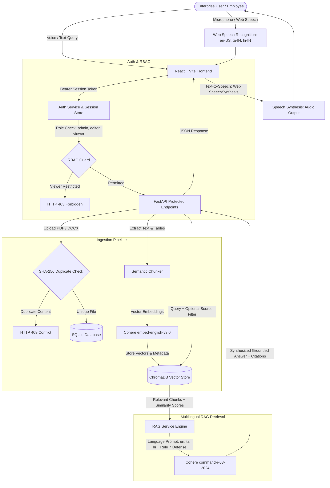

# KnowledgeHub AI — Intelligent Company Document Assistant (RAG)

KnowledgeHub AI is an enterprise-grade Retrieval-Augmented Generation (RAG) document assistant designed for confidential enterprise knowledge bases. It ingests company documents (PDF, DOCX), extracts text and tabular structures, generates semantic vector embeddings using Cohere, indexes them into a persistent ChromaDB vector store, and provides grounded question-answering with exact document citations, multilingual response generation (English, Tamil, Hindi), browser-native voice assistance (STT/TTS), and secure role-based access control (RBAC).

---

## Architecture Overview



---

## Tech Stack

| Layer | Technology |
|---|---|
| **Frontend** | React 18 / 19, Vite, Tailwind CSS v4, Lucide React Icons |
| **Voice Processing** | Web Speech API (`webkitSpeechRecognition` STT + `SpeechSynthesis` TTS) |
| **Localization (i18n)** | Custom zero-dependency translation store (English `en`, Tamil `ta`, Hindi `hi`) |
| **Backend API** | FastAPI, Uvicorn, Pydantic v2 |
| **Authentication & RBAC** | Passlib `bcrypt` (12 rounds), SHA-256 session tokens, role-based dependencies |
| **Relational Database** | SQLite (`knowledgehub.db` via SQLAlchemy ORM) |
| **Vector Store** | ChromaDB (Persistent local embeddings with cosine distance) |
| **Embedding Engine** | Cohere API (`embed-english-v3.0`, 1024-dim) |
| **Generation Engine** | Cohere Chat (`command-r-08-2024`) |
| **Document Parsers** | PyPDF, `pdfplumber` (tables), `python-docx` |
| **Testing** | Pytest, HTTPX TestClient (65 unit & integration tests) |

---

## Project Structure

```
KNOWLEDGE AI PROJECT/
├── backend/
│   ├── app/
│   │   ├── api/             # FastAPI routers (auth, documents, search, health)
│   │   │   ├── auth.py      # Registration, login, profile, reset password
│   │   │   ├── documents.py # Upload, index, list, delete, stream
│   │   │   ├── search.py    # Semantic search and multilingual RAG ask
│   │   │   └── health.py    # Health check & vector statistics
│   │   ├── config.py        # Environment settings (Cohere, Auth, DB)
│   │   ├── database.py      # SQLite connection & sessionmaker
│   │   ├── models/          # SQLAlchemy schemas (User, Session, Token, Document, Chunk)
│   │   ├── services/        # Auth, RAG, Chunker, Vector store, Extractors
│   │   │   ├── auth.py      # Password hashing, validation, session lifecycle
│   │   │   ├── rag.py       # Grounded RAG with language-aware system prompts
│   │   │   └── vector_store.py # ChromaDB client & indexing operations
│   │   └── main.py          # FastAPI application lifespan & initial admin seeder
│   ├── tests/               # Pytest test suite (65 unit & integration tests)
│   │   ├── conftest.py      # Global fixtures & dependency overrides
│   │   ├── test_auth.py     # Auth, RBAC, password strength & reset tests
│   │   ├── test_ingestion.py# File upload, deduplication & corrupted file tests
│   │   ├── test_vector_rag.py# ChromaDB, citations, RAG & prompt injection tests
│   │   └── test_health.py   # Health check & table creation tests
│   ├── data/                # Local SQLite DB, ChromaDB storage, uploads
│   ├── requirements.txt     # Python backend dependencies
│   └── .env.example         # Template for backend environment variables
├── knowledgehub-ai/
│   ├── src/
│   │   ├── components/
│   │   │   ├── AIAssistant.jsx # Multilingual Q&A, voice mic, audio playback
│   │   │   └── Login.jsx       # 4-mode auth: Login, Register, Forgot, Reset
│   │   ├── services/
│   │   │   ├── api.js          # Centralized API client with automatic token injection
│   │   │   └── translations.js # Complete English, Tamil, and Hindi dictionaries
│   │   ├── App.jsx             # Root layout, navigation, RBAC guards & Settings
│   │   └── main.jsx            # React mount point
│   ├── package.json         # Node.js dependencies and scripts
│   └── .env.example         # Template for Vite frontend environment
├── .gitignore               # Protects virtual environments, SQLite DB, uploads, secrets
└── README.md                # Comprehensive project documentation
```

---

## Authentication & Role-Based Access Control (RBAC)

### User Roles & Permissions Matrix

| Capability | Administrator (`admin`) | Editor (`editor`) | Viewer (`viewer`) |
|---|:---:|:---:|:---:|
| **Sign In & View Profile** | ✅ | ✅ | ✅ |
| **Search & Ask AI Assistant** | ✅ | ✅ | ✅ |
| **View / Download Documents** | ✅ | ✅ | ✅ |
| **Upload PDF / DOCX Files** | ✅ | ✅ | ❌ (Blocked with 403) |
| **Re-index Document Vectors** | ✅ | ✅ | ❌ (Blocked with 403) |
| **Delete Documents & Purge Vectors** | ✅ | ✅ | ❌ (Blocked with 403) |
| **System Settings & Diagnostics** | ✅ | ✅ | ✅ (Read-Only) |

> **Security Note**: All new user registrations default safely to the `viewer` role. Self-granting `admin` or `editor` status during registration is explicitly prohibited in the backend API.

### Initial Administrator Account
During server startup, the backend checks for an initial administrator. If none exists, it seeds:
- **Email**: `admin@knowledgehub.internal`
- **Initial Password**: `AdminSecure2026!` (configurable via `.env` `INITIAL_ADMIN_EMAIL` / `INITIAL_ADMIN_PASSWORD`)
- **Role**: `admin`

---

## Multilingual Support & Voice Capabilities

### Supported Languages
1. **English (`en`)**: Native interface and Cohere generation.
2. **Tamil (`ta`)**: Complete UI translation and Cohere Tamil response generation (*"ஊழியர்களுக்கான முக்கிய பாதுகாப்பு வழிகாட்டுதல்கள் யாவை?"*).
3. **Hindi (`hi`)**: Complete UI translation and Cohere Hindi response generation (*"कंपनी की नीतियों के अनुसार मुख्य दिशानिर्देश क्या हैं?"*).

### Voice Input (Speech Recognition)
- Browser-native Web Speech API (`webkitSpeechRecognition` / `SpeechRecognition`).
- Dynamic speech recognition locale matching:
  - English: `en-US`
  - Tamil: `ta-IN`
  - Hindi: `hi-IN`
- Visual pulsing red recording indicator with real-time transcript streaming.

### Voice Output (Text-to-Speech)
- Browser-native Speech Synthesis (`window.speechSynthesis`).
- **Citation Stripping**: Intelligently removes references like `[Source 1: report.pdf (Page 1)]` before speaking so the voice reads natural, conversational prose.
- **Configurable Speech Rate**: Adjustable from `0.75x` to `1.5x` in Settings.
- **Auto-Read Toggle**: When enabled, AI responses begin speaking automatically upon generation.
- **Test Speech Playback**: One-click test button in Settings to verify audio synthesis in the active language.

---

## Installation & Setup

### Prerequisites
- Python 3.10+ installed
- Node.js 18+ and npm installed
- Cohere API Key (obtain free key from [Cohere Dashboard](https://dashboard.cohere.com/api-keys))

---

### Backend Setup

1. Open PowerShell and navigate to the backend directory:
   ```powershell
   cd "c:\Users\windows\Desktop\KNOWLEDGE AI PROJECT\backend"
   ```

2. Activate the virtual environment:
   ```powershell
   .\venv\Scripts\Activate.ps1
   ```

3. Install required Python packages:
   ```powershell
   pip install -r requirements.txt
   ```

4. Configure environment variables in `.env`:
   ```ini
   COHERE_API_KEY=your_cohere_api_key_here
   COHERE_EMBED_MODEL=embed-english-v3.0
   COHERE_CHAT_MODEL=command-r-08-2024
   API_HOST=127.0.0.1
   API_PORT=8000
   SESSION_EXPIRE_HOURS=24
   PASSWORD_RESET_EXPIRE_MINUTES=30
   INITIAL_ADMIN_EMAIL=admin@knowledgehub.internal
   INITIAL_ADMIN_PASSWORD=AdminSecure2026!
   ```

5. Start the backend server:
   ```powershell
   .\venv\Scripts\python -m uvicorn app.main:app --reload --host 127.0.0.1 --port 8000
   ```
   Interactive Swagger documentation is available at [http://127.0.0.1:8000/docs](http://127.0.0.1:8000/docs).

---

### Frontend Setup

1. Open a new PowerShell terminal and navigate to the frontend directory:
   ```powershell
   cd "c:\Users\windows\Desktop\KNOWLEDGE AI PROJECT\knowledgehub-ai"
   ```

2. Install dependencies:
   ```powershell
   npm install
   ```

3. Configure environment variables in `.env`:
   ```ini
   VITE_API_BASE_URL=http://127.0.0.1:8000
   ```

4. Start the frontend development server:
   ```powershell
   npm run dev
   ```
   Open your browser at [http://localhost:5173](http://localhost:5173).

---

## API Reference

### Authentication Endpoints
| Method | Endpoint | Description | Auth Required |
|---|---|---|:---:|
| `POST` | `/api/auth/register` | Register new user (defaults to `viewer` role) | No |
| `POST` | `/api/auth/login` | Login with email and password, returns bearer token | No |
| `GET` | `/api/auth/me` | Fetch authenticated user profile and permissions | Yes (Bearer) |
| `POST` | `/api/auth/logout` | Revoke active session token | Yes (Bearer) |
| `POST` | `/api/auth/forgot-password` | Generate reset token (includes dev token helper) | No |
| `POST` | `/api/auth/reset-password` | Set new password using valid reset token | No |

### Document & RAG Endpoints
| Method | Endpoint | Description | RBAC Requirement |
|---|---|---|:---:|
| `GET` | `/api/health` | Health check returning API, SQLite, and ChromaDB status | Public |
| `POST` | `/api/documents/upload` | Multipart file upload with SHA-256 deduplication & chunking | `admin`, `editor` |
| `GET` | `/api/documents` | Lists accessible documents with status, chunk counts, and errors | All authenticated users |
| `GET` | `/api/documents/{id}` | Retrieves metadata of a single document (confidentiality guarded) | All authenticated users |
| `DELETE` | `/api/documents/{id}` | Deletes record, disk file, and purges ChromaDB vectors | `admin`, uploader |
| `POST` | `/api/documents/{id}/index` | Re-indexes document vectors into ChromaDB | `admin`, `editor` |
| `GET` | `/api/documents/{id}/file` | Secure file stream (Bearer header or `?token=` parameter) | All authenticated users |
| `POST` | `/api/rag/ask` | Grounded multilingual RAG Q&A with exact citations & session isolation | All authenticated users |
| `POST` | `/api/rag/search` | Direct semantic vector search across document chunks | All authenticated users |
| `GET` | `/api/rag/sessions` | Lists user's isolated chat sessions | All authenticated users |
| `GET` | `/api/rag/sessions/{id}` | Retrieves full conversation transcript (ownership enforced with 403) | All authenticated users |
| `DELETE` | `/api/rag/sessions/{id}` | Deletes chat session (ownership enforced with 403) | All authenticated users |
| `GET` | `/api/dashboard/stats` | Real-time system statistics and user-isolated conversation counts | All authenticated users |

---

## Running Verification Tests

### Backend Test Suite (65 Tests)
Execute all 65 automated unit and integration tests:
```powershell
cd "c:\Users\windows\Desktop\KNOWLEDGE AI PROJECT\backend"
.\venv\Scripts\pytest -v
```

**Test Coverage Summary**:
- **19 Auth, RBAC & Isolation Tests**: `bcrypt` hashing, password strength validation, user registration, duplicate rejection, login, token revocation, expired token rejection, forgot/reset flow, 401 unauthorized protection, 403 viewer role restrictions, multilingual RAG dispatch, conversation session isolation, user-isolated session listing and deletion, restricted document cross-user access prevention, document deletion ownership check, dashboard statistics isolation, and multi-turn conversational follow-up memory.
- **18 Ingestion Tests**: PDF/DOCX parsing, tabular extraction, sliding window chunking, SHA-256 deduplication (`409`), path traversal protection, corrupted file handling, and consistent delete cascading.
- **25 Vector & RAG Tests**: ChromaDB upsert/query/purge, Cohere embeddings, grounded Q&A, citation deduplication, source isolation, low-similarity threshold filtering, and Rule 7 anti-prompt-injection.
- **3 System Health Tests**: Root endpoint, database table creation, and service health check.

### Frontend Production Build
Verify TypeScript/JSX syntax, translation integrity, Tailwind CSS compilation, and bundle health:
```powershell
cd "c:\Users\windows\Desktop\KNOWLEDGE AI PROJECT\knowledgehub-ai"
npm run build
```

---

## Senior Demonstration Runbook

1. **Authentication Experience**:
   - Navigate to `http://localhost:5173`.
   - Sign in with Administrator credentials (`admin@knowledgehub.internal` / `AdminSecure2026!`).
   - Observe role badge (`admin`) in the header and sidebar.
   - Register a new user (`viewer@company.com`).
   - Notice the system assigns the safe `viewer` role by default.
   - Demonstrate the Forgot Password workflow: generate a reset token and update the password.
2. **Role-Based Access Control**:
   - Log in as the `viewer` user.
   - Attempt to upload or delete a document; observe that the UI and backend reject the action with a clear permission notification.
   - Re-login as `admin` to perform document uploads.
3. **Multilingual Interface & RAG**:
   - Change UI language to **தமிழ் (Tamil)** using the header dropdown.
   - Observe instant translation across sidebar, dashboard stats, buttons, and headers.
   - Ask the AI Assistant in Tamil: *"ஊழியர்களுக்கான முக்கிய பாதுகாப்பு வழிகாட்டுதல்கள் யாவை?"*
   - Verify that the response is formulated in Tamil while citing exact page numbers from indexed documents.
   - Switch language to **हिन्दी (Hindi)** and test Hindi responses.
4. **Voice Interaction (STT & TTS)**:
   - Click the microphone icon in the AI Assistant chat bar.
   - Speak a question (e.g., *"What is Rahul Kumar's department?"*).
   - Watch the voice transcript populate and submit automatically.
   - Click the **Read Aloud** speaker button on the answer bubble to hear natural audio synthesis with citations stripped.
   - Enable **Auto-read responses** in Settings and adjust speech speed (`1.25x`).
5. **System Settings & Diagnostics**:
   - Navigate to **Settings**.
   - Show active user identity, token verification status, Cohere model identifiers, ChromaDB vector store health, and live chunk statistics.
